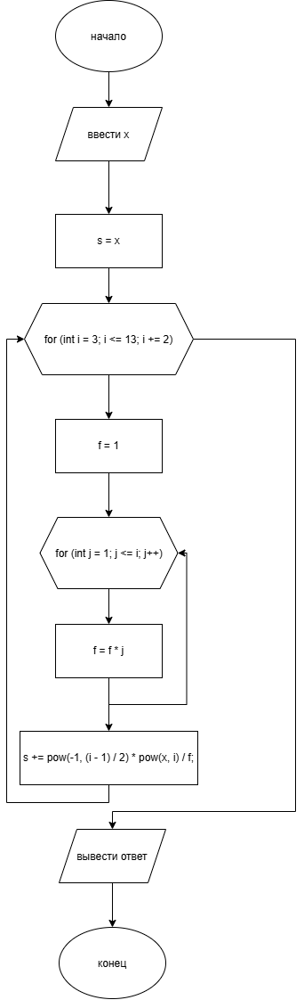

# Домашнее задание к работе 8

## Условие задачи

Задано значение х, вычислить x − x³/3! + x⁵/5! − x⁷/7! + x⁹/9! − x¹¹/11! + x¹³/13!
---

## 1. Алгоритм и блок-схема

### Алгоритм

1. Объявить переменную `x`, `s` типа double, `f` типа int.
2. Запросить у пользователя число (`x`).
3. Написать алгоритм для вычисления степени for (int i = 3; i <= 13; i += 2).
4. Написать алгоритм для вычисления факториала for (int j = 1; j <= i; j++) {f *= j;}.
5. Рассчитать уравнение.
6. Вывести ответ.
7. Завершить программу.

## Блок-схема

---

## 2. Реализация программы
---

## 3. Результаты работы программы

Пример работы программы при вводе  **5**  :

---

Введите x:5

Ответ: -0.501801

---

## 4. Информация о разработчике

- **ФИО:** Губский Данил Максимович
- **Группа:** бОТИ-261
